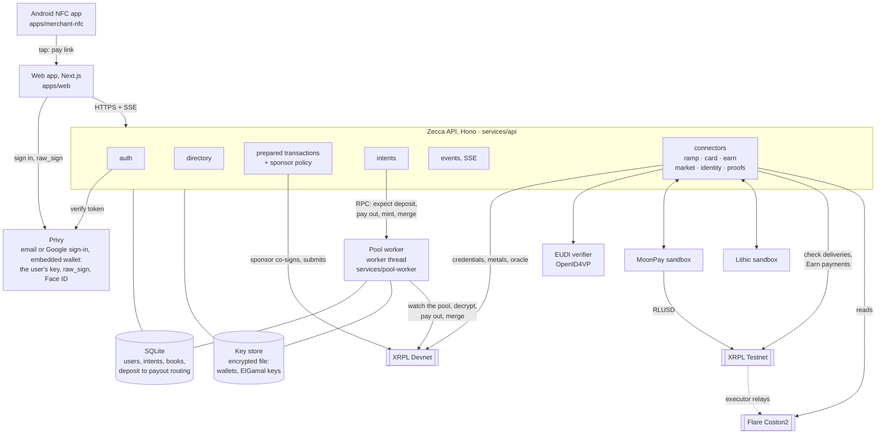
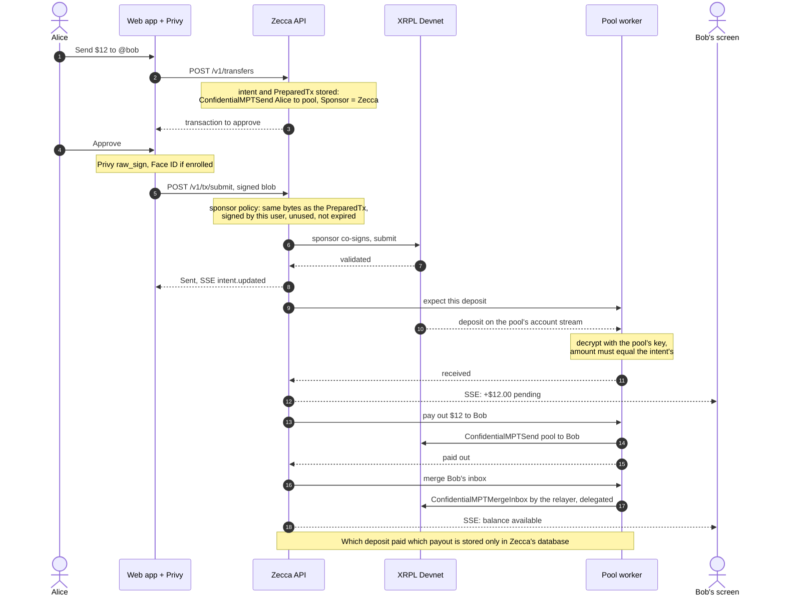
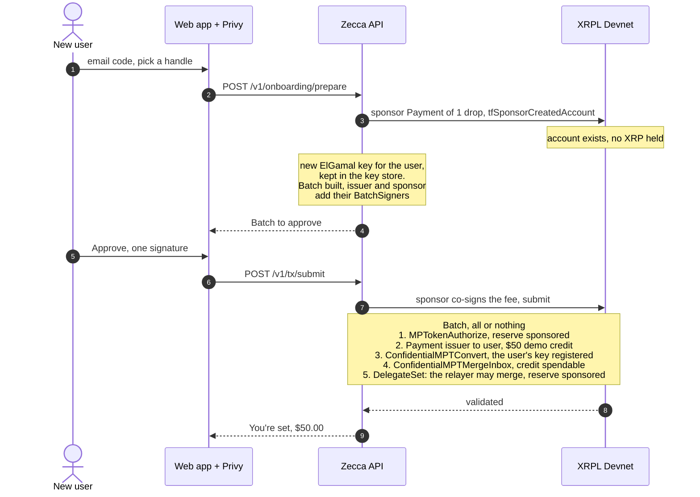
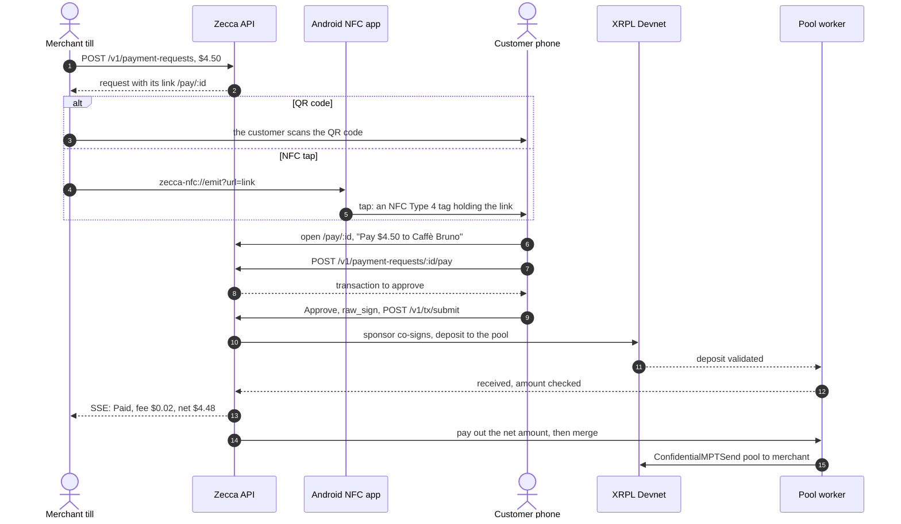
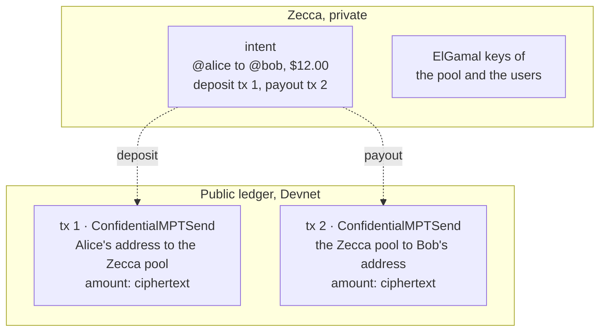
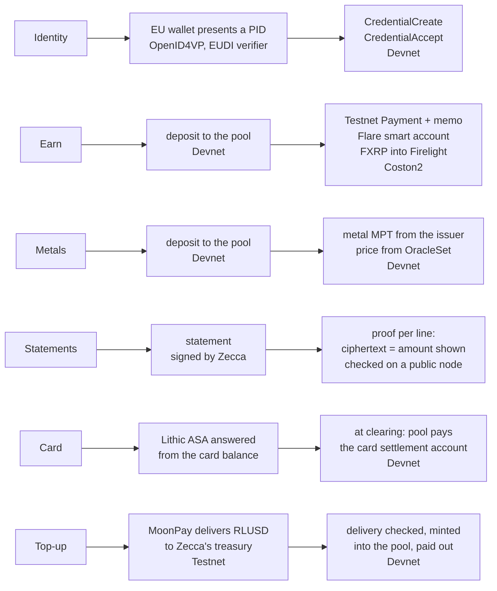

# Zecca

Zecca is a payment app in the style of Revolut or Wise that runs on the XRP Ledger, layer 1: sign in with an email, pay with a tap or a QR code, and your balance and the amounts you send stay hidden on the public ledger.
You never see a seed phrase and never hold XRP: Zecca opens your account and pays every network fee, and you sign each payment with your own key.

Built at the Italian XRPL Hackathon 2026 (Bari), Track 2. Running on XRPL Devnet and Testnet.

## Try it

https://zecca-beta.vercel.app — sign up with an email (you get $50 of demo credit), send money to someone, open a payment and switch "What the ledger shows" to *Everyone else*. The click path a judge needs, and what each screen proves on the ledger, is in [DEMO.md](DEMO.md).

## Features

| Feature | XRP Ledger primitive | Where in the code |
|---|---|---|
| An account without holding XRP | Sponsored account creation: a 1-drop `Payment` with `tfSponsorCreatedAccount` from Zecca's sponsor | `packages/xrpl-core/src/ledger.ts` (`ensureAccount`) |
| Sign-up in one approval | `Batch`, all or nothing, signed once by the user | `services/api/src/onboarding.ts`, `packages/xrpl-core/src/confidential.ts` (`buildOnboarding`), `packages/xrpl-core/src/batch.ts` |
| Every fee paid by Zecca | Sponsor co-signature (`Sponsor`, `SponsorSignature`) on each user transaction | `packages/xrpl-core/src/sponsor.ts`, `services/api/src/prepared/` (sponsor policy) |
| Hidden balances and amounts | Confidential MPT: `ConfidentialMPTConvert`, `ConfidentialMPTSend`, `ConfidentialMPTMergeInbox` (ElGamal ciphertexts and zero-knowledge proofs) | `packages/xrpl-core/src/confidential.ts`, `services/api/src/intents/flow.ts`, `services/pool-worker/src/worker.ts` |
| Incoming money becomes spendable without an approval | Permission delegation: `DelegateSet` lets Zecca's relayer send `ConfidentialMPTMergeInbox` for the user | `packages/xrpl-core/src/confidential.ts`, `services/api/src/prepared/account-gate.ts` |
| Pay a shop by QR code or NFC tap | The same confidential deposit to the pool, from a payment request link | `services/api/src/paymentRequests/`, `apps/web/app/pay/`, `apps/merchant-nfc/` |
| Face ID on approvals | Privy passkey check on the `raw_sign` that signs the transaction | `apps/web/lib/passkey/`, `apps/web/lib/wallet/privy.ts` |
| Verified identity raises limits | Credentials: `CredentialCreate` by Zecca's KYC issuer, `CredentialAccept` signed by the user | `services/api/src/connectors/identity/` |
| Top up with a card | MoonPay sandbox delivers RLUSD by `Payment` on Testnet; once that is checked, Zecca's issuer mints the credit into the pool on Devnet (`Payment`, then `ConfidentialMPTConvert`) and the pool pays it out | `services/api/src/connectors/ramp/` |
| Payment card | Lithic sandbox card; purchases settled by a `ConfidentialMPTSend` from the pool to the card settlement account | `services/api/src/connectors/card/` |
| Earn | A Testnet `Payment` with a memo instruction opens a Flare smart account, which deposits into the Firelight vault on Flare Coston2 | `services/api/src/connectors/earn/` |
| Gold, silver, palladium | One MPT per metal; prices published on the ledger with `OracleSet` | `services/api/src/connectors/market/` |
| Statements with proofs | A proof per line that a `ConfidentialMPTSend` ciphertext encrypts the amount shown, checked against a public node | `services/api/src/connectors/proofs/` |

## How it works

Every payment goes through the Zecca pool: you send a confidential transfer to the pool, the pool checks the amount and sends a second confidential transfer to the person or shop you paid. The ledger shows two payments, to and from the pool, with the addresses visible and the amounts encrypted. Which deposit pays which recipient lives only in Zecca's database; no memo, tag or field on the ledger links them. The app's `/how-it-works` page gives the full picture, network by network; [docs/SPEC.md](docs/SPEC.md) has the ledger model.

### System architecture

The web app talks to one HTTP API; the API prepares each transaction the user approves, the user signs it in the browser with their Privy key, and the pool worker on its own thread is the only part that moves money out of the pool.



### One payment

The user signs a deposit to the pool; the sponsor co-signs only the exact transaction the API prepared; the pool worker decrypts the deposit and pays the recipient with a second confidential transfer.



### Sign-up in one signature

The sponsor creates the account with 1 drop, then the user signs one Batch; the inner transactions below are listed in the order `buildOnboarding` puts them.



### Paying a merchant by QR code or NFC

A charge on the till is a payment request whose link is the QR code, or the NFC tag the Android app emulates; the till shows "Paid" when the pool has checked the deposit, and the payout follows in the background.



### What the public ledger sees and what Zecca knows

Anyone reading Devnet sees two transfers with encrypted amounts; the link between them, and the amounts in clear, are only in Zecca's database and key store.



| | Public ledger | Zecca |
|---|---|---|
| Addresses | Visible | Visible |
| Balances and amounts | ElGamal ciphertexts, with zero-knowledge proofs | Decrypted with the keys in its key store |
| Who paid whom | Payer to pool, pool to recipient | The intent links the deposit to its payout |
| Names and emails | Not on the ledger | In its database |
| Time of each transaction | Visible | Visible |

### Phase-2 connectors at a glance

Each connector is behind its own `FEATURE_*` flag and ends in an XRP Ledger transaction or a check against one.



## Proven on the ledger

Transactions from our test runs and from production on 20 and 21 November 2026. Devnet is reset from time to time, so these links can expire.

| What | Network | Transaction |
|---|---|---|
| Account created by the sponsor with 1 drop | Devnet | [`C4225559…40EC`](https://devnet.xrpl.org/transactions/C42255597710602E16C35FF416082D506C96598377F4210D5E42E847119740EC) |
| One-signature sign-up Batch (authorize, credit, convert to confidential, merge) | Devnet | [`C8594C53…AB55`](https://devnet.xrpl.org/transactions/C8594C5337AC38A74A7E3EBCF8333706372667453307E25DFAFA1C8E6ADCAB55) |
| Sign-up Batch on production, with the relayer's `DelegateSet` | Devnet | [`64DB5BCA…8B10`](https://devnet.xrpl.org/transactions/64DB5BCA3C9CB50F1966221BE53DDAB6C273813B7DA46D4B0661C2C2FD9F8B10) |
| Confidential send to the pool, fee sponsored | Devnet | [`D1DAE5A9…3777`](https://devnet.xrpl.org/transactions/D1DAE5A97DDCA1590AE6E3E489378AA7EAEDD44500DD7B0E76670CA135A83777) |
| Payout: confidential send from the pool to the recipient | Devnet | [`9D7B2D19…7A60`](https://devnet.xrpl.org/transactions/9D7B2D19449EC3934F899DEDB7C181E3FF01027FCA56A82B136A636C4C537A60) |
| The relayer merges the recipient's inbox (delegated `ConfidentialMPTMergeInbox`) | Devnet | [`F1B54C10…8F94`](https://devnet.xrpl.org/transactions/F1B54C10C43A917A6B8D0124E7C7FC7BABBD1F43054E0FD59EB6FB15ADB68F94) |
| MoonPay sandbox purchase delivered as RLUSD | Testnet | [`548D695E…8939`](https://testnet.xrpl.org/transactions/548D695E91F1F48720D64F0380C084DE3E0A6A4F97CA1599B79324FB5A1F8939) |
| One XRPL payment into the Firelight vault on Flare | Testnet | [`B53177C7…5307`](https://testnet.xrpl.org/transactions/B53177C7D31A4CC4F786824150F72A4EFE206DC7818989E98CC80A74E71B5307) |

Long-lived Devnet accounts: pool [`rNwvGErbykbsfcRnmq6fXhqmrrL94WcZSZ`](https://devnet.xrpl.org/accounts/rNwvGErbykbsfcRnmq6fXhqmrrL94WcZSZ), sponsor [`rBCtijgiPFRnLxazz8LMqbkP8zBicWhFxT`](https://devnet.xrpl.org/accounts/rBCtijgiPFRnLxazz8LMqbkP8zBicWhFxT), issuer [`rB5Pc1c7EYx98o4iWfk4Jx96JrCWgqhfZ3`](https://devnet.xrpl.org/accounts/rB5Pc1c7EYx98o4iWfk4Jx96JrCWgqhfZ3); confidential token (MPT issuance) `006C6AA175853178147D8F0D592D9DE3658C836F69985AB9`.

## Run it locally

Node 22.12 or later and npm. No network is needed: the default mode is an in-memory ledger with a local test signer.

```sh
git clone https://github.com/FehlmannDy/Zecca.git && cd Zecca
npm install
npm run env:setup   # creates .env (mode 600) with a fresh key store passphrase; prints key names only
npm run dev         # API on :8800 (with the pool worker) and the web app on :3100
# open http://localhost:3100
```

To run against the real XRPL Devnet, set `LEDGER_MODE=devnet` in `.env`, run `npm run bootstrap` once (it creates the sponsor, issuer, pool and the other accounts from the faucets, plus the confidential token; a second run creates nothing), then `npm run dev`. Signing in with a real email needs `SIGNER_MODE=privy` and a Privy app (`PRIVY_APP_ID`, `PRIVY_APP_SECRET`). Every variable is listed with its default in [`.env.example`](.env.example).

## Tests

| Command | What it runs |
|---|---|
| `npm test` | Unit and contract tests on the in-memory ledger (Vitest, a few seconds, no network) |
| `npm run test:ledger` | Real transactions on XRPL Devnet and Testnet (needs the network and a bootstrapped key store) |
| `npm run test:e2e` | The demo path in a real browser (Playwright): sign up, balance, send, pay a merchant, "Paid" |
| `npm run typecheck` | TypeScript, strict, over every package |

## Repository layout

```
apps/
  web/              Next.js: landing, user space, merchant space, pay page, demo shop
  merchant-nfc/     Android app that hands the pay link to the customer's phone over NFC (release/zecca-nfc.apk)
services/
  api/              HTTP API (Hono): auth, directory, prepared transactions, sponsor policy, intents, events, connectors
  pool-worker/      Worker thread: watches the pool, decrypts and checks deposits, pays out
packages/
  contracts/        Shared schemas (zod), types, fixtures: the API and the web are built against them
  xrpl-core/        Signer, sponsor co-signature, Batch builder, confidential helpers, live ledger client
  keystore/         Key store interface and its encrypted-file implementation
  ledger-mock/      In-memory ledger with the same state machine (LEDGER_MODE=mock)
scripts/            setup-env, import-keys, bootstrap-ledger, tunnel, smoke test
e2e/                Playwright: the demo path
docs/               SPEC.md (product and ledger model), UI.md (interface), DECISIONS.md
```

Deployment (API as one Docker image, web on Vercel) is described in [DEPLOY.md](DEPLOY.md).

## Licence

[MIT](LICENSE)
